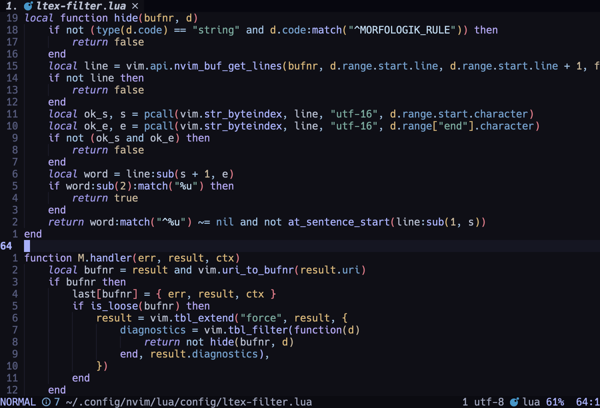
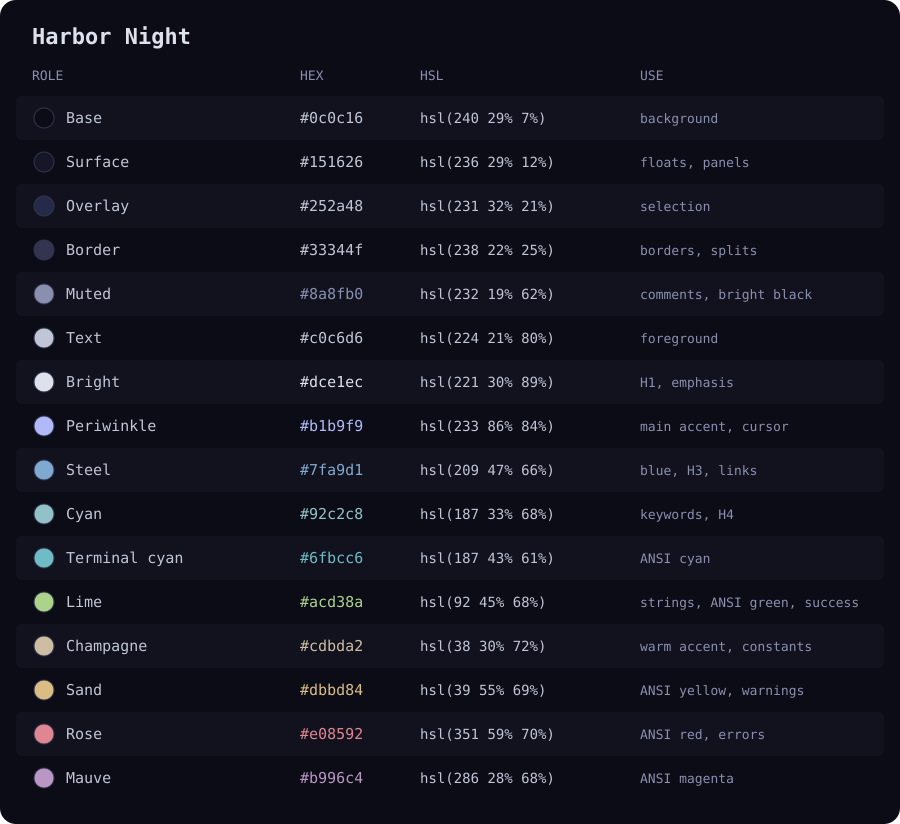

# Dotfiles

## Overview

My macOS dotfiles and development environment configuration, managed with [yadm](https://yadm.io).

yadm keeps configuration files in their normal locations under `$HOME` while providing Git-based version control and synchronization.

## Theme: Harbor Night

A custom low-glare dark palette with a periwinkle accent and muted, evenly weighted accent colors, applied across Alacritty, Neovim, tmux, zsh, delta, lazygit, Hammerspoon and Claude Code.

## Regular Maintenance

To update and track dependencies, sync lazy.nvim plugins and run `dua` regularly, typically weekly.

See [`.aliases`](./.aliases) for the associated commands and aliases.
